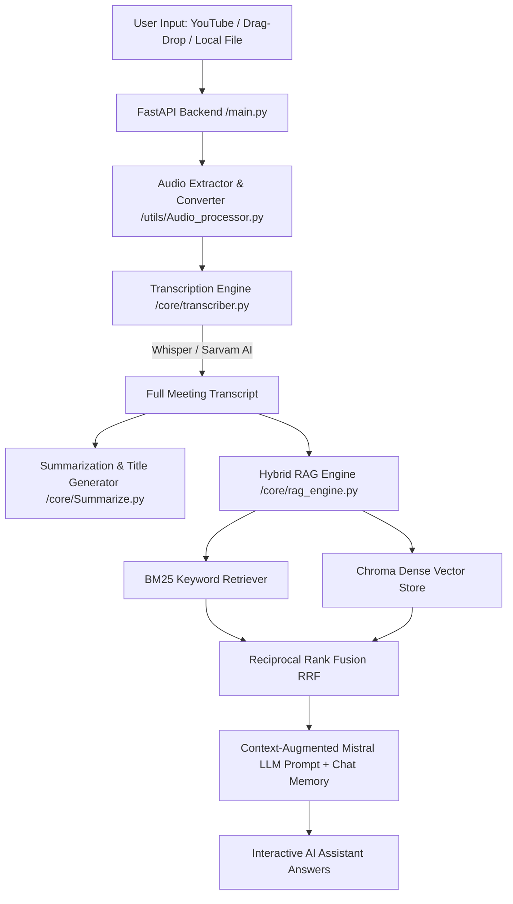

# 🎙️ AI Video Meeting Assistant with Hybrid RAG

An end-to-end intelligent meeting assistant and RAG Q&A application built with **FastAPI**, **LangChain**, **BM25 + Chroma Hybrid Search**, **Conversational Memory**, and **Whisper / Sarvam AI**.


---

## ✨ Features

- 📥 **Multi-Source Input Processing**:
  - **YouTube URLs**: Instant audio extraction via `yt-dlp`.
  - **Drag & Drop Upload**: Upload audio/video files directly from your device (`.mp3`, `.wav`, `.m4a`, `.mp4`, `.mkv`, `.txt`).
  - **Server File System Explorer**: Select pre-stored files directly from local server directories.
- 🧠 **Hybrid Search RAG Architecture**:
  - **Sparse Keyword Search**: `BM25Retriever` (`rank_bm25`) catches exact names, numbers, and technical terms.
  - **Dense Vector Search**: HuggingFace Embeddings (`all-MiniLM-L6-v2`) + `ChromaDB` for semantic concept retrieval.
  - **Reciprocal Rank Fusion (RRF)**: Re-ranks and merges keyword and vector search results for maximum context relevance.
- 💬 **Conversational Memory**:
  - Session chat history buffer allows users to ask multi-turn follow-up questions naturally (e.g. *"Who said that?"*, *"Summarize the second action item in detail"*).
- 🎙️ **Dual Transcription Engines**:
  - **Whisper (Local)**: High-accuracy English speech-to-text.
  - **Sarvam AI API**: Synchronous STT with automatic **Hinglish / Hindi → English** translation.
- 📊 **Executive Meeting Dashboard**:
  - Automated title generation, executive summaries, key decisions, and action item extractions powered by **Mistral LLM**.
  - Transcript search filter, text copy, and **TXT / JSON** data exports.
- 🎨 **Modern UI**:
  - Clean glassmorphism dark-mode UI built with Vanilla HTML5, CSS3, and JavaScript.

---

## 🏗️ Architecture Overview



---

## 📂 Project Structure

```
AI-Video-Meeting-Assistant-with-RAG/
├── main.py                   # FastAPI application & server runner
├── core/
│   ├── extractor.py          # Pipeline coordinator for YT/File extraction
│   ├── transcriber.py        # Whisper local model & Sarvam AI STT handler
│   ├── Summarize.py          # Executive summarization & title generation (Mistral LLM)
│   ├── vector_store.py       # HuggingFace Embeddings & Chroma vector store manager
│   └── rag_engine.py         # HybridRAG class (BM25 + Chroma + RRF + Memory)
├── utils/
│   └── Audio_processor.py    # yt-dlp downloader, FFmpeg conversion, audio chunker
├── templates/
│   └── index.html            # Main HTML5 single-page application dashboard
├── static/
│   ├── css/
│   │   └── style.css         # Glassmorphic dark mode stylesheet
│   └── js/
│       └── app.js            # Drag-and-drop, API fetch calls, Chat UI logic
├── downloads/                # Storage for processed audio/video & vector indices
├── requirements.txt          # Python dependencies
└── .env                      # API keys configuration
```

---

## 🚀 Quick Start

### 1. Prerequisites
- **Python 3.10+** installed.
- **FFmpeg** installed and added to system `PATH` (required for `pydub` and `yt-dlp`).

### 2. Clone Repository & Setup Environment
```bash
git clone https://github.com/100Rabh-19/AI-Video-Meeting-Assistant-with-RAG.git
cd AI-Video-Meeting-Assistant-with-RAG

# Create virtual environment
python -m venv .venv
# Activate on Windows:
.venv\Scripts\activate
# Activate on Linux/macOS:
source .venv/bin/activate
```

### 3. Install Dependencies
```bash
pip install -r requirements.txt
```

### 4. Configure Environment Variables (`.env`)
Create a `.env` file in the root directory with your API keys:
```env
MISTRAL_API_KEY="your_mistral_api_key_here"
WHISPER_MODEL="small"
SARVAM_AI_API="your_sarvam_api_key_here"
SARVAM_STT_MODEL="saaras:v2.5"
HUGGINGFACE_API_KEY="your_huggingface_api_key_here"
```

---

## 💻 Running the Application

Launch the server using `main.py`:
```bash
python main.py
```
Or using Uvicorn directly:
```bash
uvicorn main:app --reload --port 8000
```

Open your browser and navigate to:
👉 **`http://127.0.0.1:8000`**

---

## 🔌 API Endpoints Summary

| Method | Endpoint | Description |
| :--- | :--- | :--- |
| `GET` | `/` | Serves the single-page HTML web interface |
| `POST` | `/api/process/yt` | Process YouTube URL (Downloads audio, transcribes, indexes) |
| `POST` | `/api/process/upload` | Process Drag-and-Drop file upload (`.mp3`, `.wav`, `.mp4`, etc.) |
| `GET` | `/api/filesystem` | Browse local server directories and media files |
| `POST` | `/api/process/filesystem` | Process selected file from server file system path |
| `POST` | `/api/chat` | Contextual Q&A query using Hybrid RAG + Chat Memory |
| `POST` | `/api/clear-memory` | Reset session conversational chat memory |

---

## 📜 License

This project is open-source under the MIT License.

### 📄 Document RAG (PDF / DOC / DOCX)
- Upload a **.pdf, .docx, .doc, .md or .txt** through Drag & Drop or the Server File Explorer - it goes through the same pipeline as audio:
  text extraction -> title + executive summary (document-style prompts) -> Hybrid RAG (BM25 + Chroma + RRF) -> chat with memory -> TXT / JSON export.
- PDF text keeps `[Page N]` markers, so answers can cite pages.
- Scanned PDFs are OCR'd automatically if Tesseract + Poppler (and `pytesseract`, `pdf2image`) are installed.
- Legacy `.doc` needs LibreOffice (`soffice`) on PATH; otherwise save as `.docx`.
- Code: `core/doc_extractor.py`; routing in `main.py` (`read_source_text`, `index_and_summarize`). Test: `python tests/test_documents.py`.
